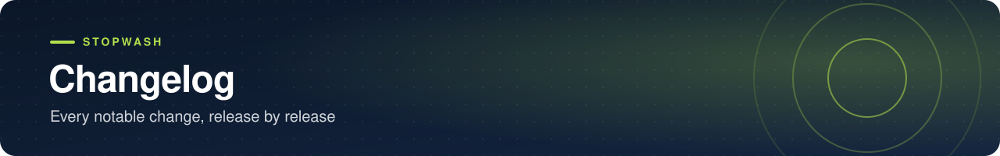

 

<strong>Every notable change to this project, newest first.</strong>

---

> [!NOTE]
> The format follows [Keep a Changelog](https://keepachangelog.com/en/1.1.0/) and the project uses [Semantic Versioning](https://semver.org/spec/v2.0.0.html). Each version links to its full comparison at the bottom of this page, and to its [release notes](https://github.com/saadmaz/Stopwash-Maintenance/releases).

## [Unreleased]

## [1.0.0] - 2026-11-18

First versioned release of the stopwash.lk maintenance fallback.

### Added

- Cloudflare Worker `stopwash-maintenance` on the route `*.stopwash.lk/*`, serving a branded 503 maintenance page (JSON for API requests) to unknown subdomains and to apps whose server is down.
- Per-host handling for `stopwash.lk`, `www.stopwash.lk`, `pos`, `accounts`, `euro`, `hr` `.stopwash.lk`.
- The official STOPWASH logo and favicon on the maintenance page, inlined as SVG so nothing is fetched.
- Behaviour tests run with Node.js, with no dependencies.
- Continuous integration on every push and pull request: formatting, tests and a dry-run bundle.
- Deploy workflow that waits for the Cloudflare Workers build of `main` and smoke-tests the live Worker.
- Project governance: proprietary licence, security policy, contribution guidelines, code of conduct, issue forms, pull request template, CODEOWNERS and Dependabot.
- Standard documentation layout shared by every STTPS repository: architecture, configuration, deployment, content, decision records (ADRs) and release and rollback runbooks, indexed in `docs/README.md`.

[Unreleased]: https://github.com/saadmaz/Stopwash-Maintenance/compare/v1.0.0...HEAD
[1.0.0]: https://github.com/saadmaz/Stopwash-Maintenance/releases/tag/v1.0.0
